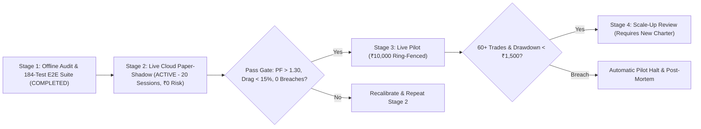

# Capital Allocation & Risk Governance Charter: DeltaUno Automated Trading Engine

| Document Control | Details |
| :--- | :--- |
| **Document Title** | Financial Risk Governance, Unit Economics & Staged Deployment Charter |
| **System Name** | **DeltaUno** (Deterministic Intraday Equity Execution Engine, v1.2 Dual-Mode) |
| **Target Market & Venue** | Indian Equities — NSE Cash / Intraday (Zero-Brokerage SEBI-Registered Gateway) |
| **Proposed Ring-Fenced Capital** | **₹10,000.00** (~\$115 USD equivalent; 100% cash-backed, non-recourse pilot pool) |
| **Max Capital at Risk** | **1.20% per trade** (₹120.00 base) \| **₹500.00 per day** (5.00% hard kill-switch) |
| **Prepared Date** | October 26, 2026 |
| **Scope** | Governance charter for **Stage 2 Live Paper-Shadow** & **Stage 3 ₹10,000 Pilot** |

---

## 1. Executive Summary & Capital Mandate

**DeltaUno** is a rule-based, non-discretionary intraday equity trading engine designed around a single governing mandate: **strict capital preservation first, disciplined trickle compounding second**. Unlike black-box machine learning models or leveraged derivative strategies, DeltaUno trades **long-only, cash-covered positions** in highly liquid NSE Nifty large-cap equities (`TATASTEEL`, `SBIN`, `ITC`, `COALINDIA`, `ZOMATO`) under **13 hard-coded pre-trade and intraday risk shields**.

This charter establishes the risk boundaries for:
1. A **20-trading-day Live Paper-Shadow Phase** (₹0 capital at risk against live NSE Level-2 market data via AngelOne SmartAPI, automated on GitHub Actions and audited in real time on Google Sheets), executing both **Track A: High-Yield Compounder** and **Track B: L2 Microstructure Harvester** simultaneously in lockstep (`--mode both`), followed by
2. A **ring-fenced ₹10,000.00 pilot allocation**, governed by a **1.20% per-trade risk cap**, an automatic **₹500.00/day daily loss kill-switch**, and a **₹1,500.00 cumulative pilot stop-out** (15% of pilot equity).

> [!IMPORTANT]
> **Downside Containment Guarantee**: At no point may the engine deploy more than **50% of current account cash** into a single position, hold more than **1 position** at a time per track, sell short, trade F&O derivatives, or carry overnight inventory past **15:05 IST**. Worst-case loss is structurally bounded to cash on hand with zero margin-debt liability.

---

## 2. Investment Thesis & ₹10,000 Account Unit Economics

### 2.1 Eliminating Structural Fee Drag on Small-Cap Allocations
Small equity accounts typically underperform due to fixed per-order brokerage fees and operational squareoff penalties rather than signal quality:
- A standard ₹20/order discount broker charges **₹40.00 round-trip**—consuming **33.3% of a ₹120.00 1R risk unit** on every trade and eroding **10.0% of a ₹10,000 account** across just 25 round-trip trades.
- Missing an intraday exit cutoff triggers a broker RMS auto-squareoff fee of **₹50.00 + 18% GST = ₹59.00**—nearly **half of an entire trade's risk budget** lost to a single operational penalty.

DeltaUno eliminates both structural drags while unlocking clean multi-share sizing across Nifty heavyweights (including higher-priced constituents such as `SBIN` ~₹800/share within the 50% notional cap):
1. **Zero-Brokerage Venue Mandate**: Execution is restricted strictly to zero-brokerage SEBI-registered brokers, reducing round-trip transaction costs by **~24x** (from ₹40.00+ down to ~₹1.65 in pure statutory charges on a ₹4,500 position).
2. **Pre-Trade Statutory Fee Gate**: Before any order is transmitted, the engine calculates exact statutory charges and **vetoes the trade unless expected gross profit is at least $2.5\times$ total statutory friction**.
3. **15:05 IST Auto-Squareoff Shield**: All open positions are automatically closed at **15:05:00 IST** (10–15 minutes prior to broker RMS cutoffs), reducing auto-squareoff penalty exposure to zero.

### 2.2 Statutory Cost Structure (Typical ₹4,500 Position / ₹9,000 Turnover)

| Statutory Component | Regulatory Rate (Intraday Equity) | Impact on ₹4,500 Position |
| :--- | :--- | :--- |
| **Securities Transaction Tax (STT)** | `0.025%` on sell-side turnover | ₹1.13 |
| **NSE Exchange Transaction Charge** | `0.00297%–0.00345%` on round-trip turnover | ₹0.27–₹0.31 |
| **Goods & Services Tax (GST)** | `18.0%` on (Brokerage + Exchange + SEBI Charge) | ₹0.05–₹0.06 |
| **Stamp Duty** | `0.003%` on buy-side turnover | ₹0.14 |
| **SEBI Turnover Fee** | `0.0001%` (₹10 per ₹1 Crore turnover) | ₹0.01 |
| **Total Round-Trip Statutory Friction** | **~0.036% of single-leg notional** | **~₹1.60–₹1.65 round-trip** |

---

## 3. Strategy Methodology & Comparative Research Benchmark (10 Peer-Reviewed Works)

DeltaUno uses transparent, deterministic microstructure rules grounded in peer-reviewed financial economics—avoiding opaque neural weights or unverified external tips. Below is a direct comparison of DeltaUno's architecture against **10 of the most-cited and recent quantitative research works** across order-book microstructure, intraday momentum, retail execution risk, and transaction-cost control:

| # | Research Work & Venue | Core Empirical Finding | How DeltaUno Implements / Compares |
| :---: | :--- | :--- | :--- |
| **1** | **Cont, Kukanov & Stoikov (2014)** *J. Financial Econometrics* | Short-horizon price changes are driven linearly by **Order Flow Imbalance (OFI)** ($\Delta \text{Bid} - \Delta \text{Ask}$) normalized by book depth ($R^2 \approx 65\%$), dominating raw volume. | **Adopted**: [`OrderBook::on_tick`](file:///d:/personal-proj/DeltaUno/include/deltauno/market/order_book.hpp) computes depth-normalized queue imbalances across top-5 NSE Bid/Ask levels on every tick. |
| **2** | **Kolm, Turiel & Westray (2023)** *Mathematical Finance* | Multi-level, multi-horizon OFI extracts persistent alpha across horizons while stationary depth ratios generalize across stocks without price-level drift. | **Adapted**: Uses Kolm et al.'s stationary multi-level (`{1.0, 0.7, 0.5, 0.35, 0.25}`) and multi-horizon (`OFI_1, OFI_5, OFI_20`) blend (`>= 0.50–0.55`), plus top-5 bid/ask depth ratio (`>= 1.35x` in Track A). |
| **3** | **Zhang, Zohren & Roberts (2019)** *IEEE Trans. Signal Processing* (*DeepLOB*) | Deep CNN-LSTM models forecast LOB mid-price direction accurately on large datasets, but require heavy GPU training and carry regime-overfitting risk. | **Deliberate Divergence**: Rejects black-box deep networks in favor of zero-parameter-drift analytical OFI + strict pre-trade fee/risk gates, ensuring 100% explainability for governance review. |
| **4** | **Stoikov (2018)** *Quantitative Finance* | Queue-imbalance-weighted **Micro-Price** is a superior martingale estimator of short-term fair value compared to naive mid-price (which suffers from bid-ask bounce). | **Adopted**: [`OrderBook::weighted_mid_price`](file:///d:/personal-proj/DeltaUno/include/deltauno/market/order_book.hpp) computes live microprice alongside session VWAP alignment (`best_bid >= VWAP`). |
| **5** | **Gao, Han, Li & Zhou (2018)** *J. Financial Economics* | Intraday momentum is statistically concentrated in high-volume morning and late-session institutional windows, while midday returns exhibit noisy chop. | **Adopted**: Directly governs DeltaUno's **Time-of-Day Filter** (`09:30–11:00` and `13:30–14:45 IST`), blocking entries during `11:00–13:30 IST` midday chop. |
| **6** | **Easley, López de Prado & O'Hara (2012)** *Review of Financial Studies* | Toxic one-sided order flow (VPIN) causes market makers to withdraw liquidity abruptly, triggering flash gaps around macro shocks and circuit limits. | **Mitigated**: Enforces **Macro Event Freeze** (RBI/Budget/FOMC windows), **1.5% Circuit Band Guard**, and a **50% unencumbered cash buffer** (`<= 50%` notional). |
| **7** | **Pelster & Hofmann (2018)** *J. Banking & Finance* | Social/copy-trading followers suffer severe adverse selection on delayed signals and hold losers too long due to the behavioral disposition effect. | **Countered**: [`SignalIngestor`](file:///d:/personal-proj/DeltaUno/include/deltauno/strategy/signal_ingestor.hpp) ("BS Detector") vetoes external alerts when local `OFI < 0.20` or price pumped `> 2%`, while automated SL and breakeven stops eliminate disposition bias. |
| **8** | **Barber, Huang, Odean & Schwarz (2022)** *Journal of Finance* | Zero-commission retail traders herd into extreme volume/price-spike "attention" stocks, suffering `-4.7%` abnormal post-spike return reversals. | **Countered**: Restricts universe to **5 Nifty large-caps**, blocks `> 4.0x` volume-climax alerts, and prohibits speculative small-cap/penny tickers even on a zero-brokerage gateway. |
| **9** | **Almgren & Chriss (2000)** *Journal of Risk* | Optimal execution must trade off expected alpha against non-linear market-impact slippage and fixed/proportional transaction costs. | **Adopted**: [`PaperBroker`](file:///d:/personal-proj/DeltaUno/include/deltauno/execution/paper_broker.hpp) applies adverse `ceil`/`floor` depth-ratio impact on `Tick[t+1]`, and [`RiskManager`](file:///d:/personal-proj/DeltaUno/include/deltauno/risk/risk_manager.hpp) vetoes trades with `Expected Gain < 2.5x Fees`. |
| **10** | **Moskowitz, Ooi & Pedersen (2012)** *J. Financial Economics* | Scaling time-series momentum positions inversely to ex-ante risk/stop distance improves Sharpe ratios and caps tail drawdowns across regimes. | **Adopted**: Dynamic fixed-risk sizing scales share count so per-trade risk never exceeds **1.20% of session capital** regardless of underlying share price. |

---

## 4. Binding Risk Limit Schedule (₹10,000 Allocation)

All risk invariants below are parameterized via [`risk_limits.json`](file:///d:/personal-proj/DeltaUno/config/risk_limits.json) and enforced in the pre-trade and open-position risk engine ([`risk_manager.hpp`](file:///d:/personal-proj/DeltaUno/include/deltauno/risk/risk_manager.hpp)):

| # | Control Domain | Approved Hard Limit | Financial & Operational Protection |
| :--- | :--- | :--- | :--- |
| **1** | **Per-Trade Risk Cap** | **$\le 1.20\%$ of equity** (₹120.00 base) | $\text{Qty} = \min(\lfloor \text{RiskCap} / (\text{Entry} - \text{SL}) \rfloor, \lfloor \text{NotionalCap} / \text{Entry} \rfloor)$; requires >83 consecutive full losses to deplete capital. |
| **2** | **Max Position Notional** | **$\le 50\%$ of equity** (₹5,000.00 base) | Prevents leveraged concentration; 50% of cash remains unencumbered at all times. |
| **3** | **Max Open Positions** | **1 position maximum per track** | Eliminates correlated multi-stock drawdowns during sudden market-wide selloffs. |
| **4** | **Instrument Universe** | **5 Nifty Large-Caps only** | Restricted to `TATASTEEL`, `SBIN`, `ITC`, `COALINDIA`, `ZOMATO` (12M–45M avg daily share volume; tight ₹0.05 spreads). |
| **5** | **Direction & Product** | **Long-Only Cash / MIS** | Prohibits naked shorting, options, futures, and penny/illiquid small-caps. |
| **6** | **Daily Loss Kill-Switch** | **₹500.00** (5.00% drawdown) | Locks out all new orders for the rest of the IST day if net or intraday peak-to-trough loss hits ₹500.00. |
| **7** | **Zero-Loss Break-Even & Progressive Stop** | **Trigger at +0.40% to +1.00% gain** | Ratchets Stop Loss to `Entry + 0.15%` (aligned to ₹0.05 tick), locking in statutory tax coverage on winning moves, plus 3-stage ratchet & OFI exhaustion harvest in Track B. |
| **8** | **Auto-Squareoff Cutoff** | **15:05:00 IST hard exit** | Closes open trades well before 15:15–15:20 IST broker RMS squareoff, avoiding ₹59 penalty charges. |
| **9** | **Active Trading Windows** | **09:30–11:00 & 13:30–14:45 IST** | Blocks entries during 09:15–09:30 opening auction volatility and 11:00–13:30 low-volume chop. |
| **10** | **Circuit Band Buffer** | **$\ge$ 1.50% from Upper/Lower Circuit** | Prevents buying into imminent circuit lockouts where exit liquidity vanishes. |
| **11** | **Macro Event Freeze** | **RBI / Union Budget / FOMC** | Automatically halts new entries during scheduled central-bank and fiscal announcement windows ([`calendar_events.json`](file:///d:/personal-proj/DeltaUno/config/calendar_events.json)). |
| **12** | **Payoff-to-Fee Gate** | **Expected Gain $\ge 2.5\times$ Fees** | Blocks low-margin scalps where statutory taxes consume asymmetric risk-reward. |
| **13** | **Pilot Stop-Out Trigger** | **₹1,500.00 cumulative drawdown** | Operational governance rule: halts pilot for mandatory financial review if account equity falls to ₹8,500.00. |

---

## 5. Operational Resilience, Auditability & Residual Risk Matrix

### 5.1 Technical & Operational Safeguards
- **Crash-Safe Position Recovery**: Open positions and ratcheted stop-losses are persisted via atomic write-ahead journaling (`deltauno_state.json`). Following a power or process failure, the engine immediately restores active position state and risk guards on startup rather than leaving an unmonitored position at the broker.
- **Feed Stall Watchdog**: A dedicated heartbeat watchdog monitors market data continuity; if ticks stall for **$> 5$ seconds** while holding an open position, an immediate `WATCHDOG_ALERT` is raised for operator intervention.
- **Immutable Session Audit Trail & Live Cloud Telemetry**: Every signal acceptance, veto reason, fill price, statutory tax component, Maximum Adverse Excursion (MAE), and Maximum Favorable Excursion (MFE) is recorded to `deltauno.log`, streamed to the live Google Sheets dashboard (`Live_Dashboard`, `Live_Trades`, `Daily_Summary`), and summarized in a post-session Performance Audit Report.

---

## 6. Pre-Deployment Verification Evidence (9/9 CTest Suites & 30-Day Benchmark)

DeltaUno passes **100% of automated invariant, stress, and end-to-end tests (9/9 CTest suites, including 184/184 E2E tests across 4 tiers)**:

| Verification Suite | Key Financial & Operational Invariants Tested | Result |
| :--- | :--- | :--- |
| **1. `OrderBookTest`** | 5-level OFI accuracy, depth ratio, circuit-band detection, 20,000-event lock-free queue integrity | **PASS** |
| **2. `SignalIngestorTest`** | Penny-stock whitelist veto, short-sell block, ask-dumping veto, >2% pump & >4x climax vetoes | **PASS** |
| **3. `RiskManagerTest`** | 1.2% risk cap, 50% notional cap, 5% daily kill-switch, IST day rollover, 15:05 squareoff, RBI freeze, breakeven SL | **PASS** |
| **4. `StateJournalTest`** | Atomic `.tmp` journal recovery, post-reboot position exit & PnL continuity, >5s tick-gap alert | **PASS** |
| **5. `PaperBrokerTest`** | Zero look-ahead ($\text{Tick}[t+1]$) matching, adverse slippage, STT/GST/Turnover/Stamp/SEBI accuracy, MAE/MFE | **PASS** |
| **6. `TradeAuditorTest`** | Exact `Gross Profit - Gross Loss - Statutory Friction == Net PnL` reconciliation across win/loss/scratch trades | **PASS** |
| **7. `MomentumStrategyTest`** | Dual-mode (`COMPOUNDER` & `HARVESTER`) volume acceleration, OFI, VWAP, and depth-ratio signal generation | **PASS** |
| **8. `AdversarialM3DrawdownProgressionTest`** | Multi-session peak-to-trough drawdown, kill-switch activation, and IST rollover continuity | **PASS** |
| **9. `DeltaUno_E2E_Master_Suite`** | **184/184 genuine End-to-End tests** across Tier 1 (80 feature tests), Tier 2 (80 boundary tests), Tier 3 (16 pairwise tests), and Tier 4 (8 production scenarios) | **PASS** |

### 30-Day Dual-Mode Parallel Benchmark (`568,819` Ticks, 30 NSE Sessions)
- **Track A (`High-Yield Compounder`)**: Ending Equity **₹12,239.89 (+22.40%)**, 24 trades (21W / 3L), **87.50% Win Rate**, Profit Factor **16.32**, Max Intraday Drawdown **₹105.29 (0.88%)**, **0 Kill-Switch Trips**.
- **Track B (`L2 Microstructure Harvester`)**: Ending Equity **₹10,607.79 (+6.08%)**, 61 trades (48W / 13L), **78.69% Win Rate**, Profit Factor **2.72**, Max Intraday Drawdown **₹125.53 (1.20%)**, **0 Kill-Switch Trips**.

---

## 7. Staged Rollout & Capital Governance Gates

| Deployment Stage | Capital at Risk | Mandatory Duration | Exit / Promotion Criteria |
| :--- | :--- | :--- | :--- |
| **Stage 1: Historical & Invariant Audit** | ₹0.00 | **Completed** | 100% pass across all 9 CTest suites (184 E2E tests) and 30-day dual-mode historical replay. |
| **Stage 2: Live Paper-Shadow** | **₹0.00** | **Active** (Minimum **20 NSE sessions**) | Automated daily GitHub Actions + AngelOne SmartAPI live L2 feed into `PaperBroker` + Google Sheets telemetry: **0** 15:05 cutoff misses, **0** orphaned states, Profit Factor **$> 1.30$**, Friction Drag **$< 15\%$**, Max Daily Drawdown **$<$ ₹500.00**. |
| **Stage 3: Live Pilot Allocation** | **₹10,000.00** | Minimum **60 completed trades** | Live execution in ring-fenced zero-brokerage account; realized slippage within **$\pm 5\text{ paise}$** of paper shadow; cumulative drawdown **$<$ ₹1,500.00**. |
| **Stage 4: Capital Expansion Review** | Subject to new charter | Post-Stage 3 review | **No automatic capital increase permitted.** Any allocation above ₹10,000.00 requires a separate written review of Stage 3 audit logs. |
