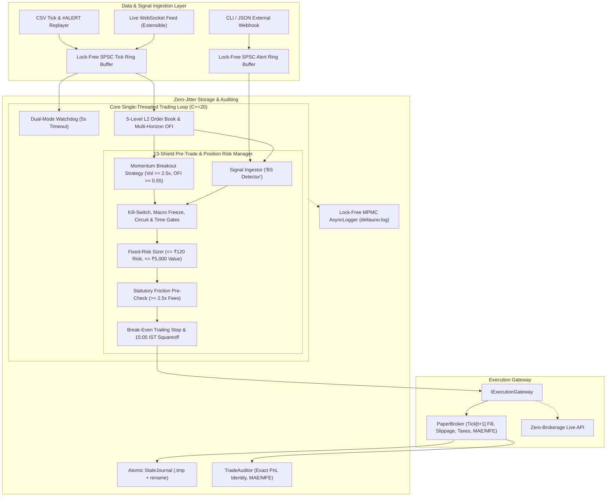

# DeltaUno: Low-Latency C++20 Trading Bot Engine — Implementation Plan

## Goal Description
Build **DeltaUno**, a modular, high-performance **C++20** algorithmic trading engine engineered for capital preservation and disciplined trickle growth on a ring-fenced pilot account of **₹10,000 (~\$115)**.

Designed for **Indian Equities (NSE/BSE)** with ₹0.05 tick-size precision and multi-asset extensibility, DeltaUno provides:
1. **High-Fidelity Paper Trading Simulation Engine** with realistic Indian statutory friction (STT, NSE turnover, GST, stamp duty, SEBI fees), Almgren-Chriss adverse slippage, tick-by-tick MAE/MFE excursion tracking, and strict zero look-ahead bias matching ($\text{Tick}[t] \to \text{Tick}[t+1]$).
2. **Hybrid Lock-Free Signal Pipeline**: Producer-consumer `SPSCRingBuffer` streams feeding an internal multi-level Order Flow Imbalance (OFI) & volume-surge breakout detector alongside an external JSON webhook ingestor ("BS Detector").
3. **13 Institutional-Grade Risk & Operational Safeguards**:
   - Dynamic Fixed-Risk Sizing ($\text{Risk} \le \text{₹}120$ per trade, $\text{Position} \le \text{₹}5,000$)
   - Net / Peak-to-Trough Daily Drawdown Kill-Switch ($\text{₹}500$ / $5\%$, auto-reset on IST day rollover)
   - Zero-Loss Break-Even Trailing Stop ($+1.0\%$ trigger $\to \text{Entry} + 0.15\%$ rounded up to ₹0.05 tick)
   - NSE Auto-Squareoff Shield (15:05 IST auto-exit avoiding ₹50+GST broker squareoff penalties)
   - Circuit Band Guard (1.5% buffer near Upper/Lower Circuits in both Strategy and `RiskManager`)
   - Time-of-Day Liquidity Filter (09:30–11:00 and 13:30–14:45 IST)
   - Zero Look-Ahead Bias State Machine (`FLAT → PENDING_ENTRY → OPEN → PENDING_EXIT`)
   - Atomic Crash Recovery State Journal (`deltauno_state.json` via `.tmp` + atomic rename, restoring `Position`, `RiskManager`, `PaperBroker`, and `Watchdog`)
   - Lock-Free MPMC Ring-Buffer Async Logger (off-thread timestamp formatting, C++20 atomic wait/notify)
   - Dual-Mode Network Heartbeat Watchdog (`steady_clock` live stall monitor + deterministic replay tick-gap detector)
   - Macro Event Calendar Freeze ($O(1)$ integer UTC-ns check loaded from `config/calendar_events.json`)
   - Statutory Friction Payoff Pre-Check ($\text{Expected Gain} \ge 2.5\times \text{Total Fees}$)
   - Post-Trade Diagnostic Auditor (MAE, MFE, Win Rate, Profit Factor, Friction Drag Ratio, exact PnL identity)
4. **Execution Gateway Abstraction**: `IExecutionGateway` interface supporting `PaperBroker` out of the box and ready for zero-brokerage live adapters (e.g., Shoonya/Finvasia).

---

## Design Decisions & Constraints

> [!NOTE]
> **Header-Only Inline C++20 Engine (`deltauno_engine`)**: All core, market, strategy, risk, and execution components are implemented as inline header-only C++20 modules under `include/deltauno/` exposed via a CMake `INTERFACE` target linked with `Threads::Threads`. This maximizes hot-path compiler inlining across template boundaries without cross-TU call overhead.

> [!IMPORTANT]
> **Zero-Brokerage Mandate**: Standard flat-fee brokers charge ₹20 per order (₹40 round-trip — consuming 33.3% of a ₹120 1R risk unit on every trade). Live execution targets strictly **zero-brokerage gateways**, while `PaperBroker` deducts every statutory tax and adverse market-impact slippage to the paisa.

---

## Architecture Overview



---

## Directory & Component Structure

```text
DeltaUno/
├── CMakeLists.txt
├── README.md
├── config/
│   ├── risk_limits.json           # Capital, drawdown, trading windows, cutoffs
│   ├── instruments.json           # Liquid NSE equity whitelist & tick sizes
│   └── calendar_events.json       # RBI, Union Budget, and FOMC freeze windows
├── docs/
│   ├── implementation_plan.md
│   └── walkthrough.md
├── include/
│   └── deltauno/
│       ├── core/
│       │   ├── types.hpp          # Fixed-point Price, 5p tick rounding, POD types
│       │   ├── ring_buffer.hpp    # Cache-aligned SPSCRingBuffer & MPMCRingBuffer
│       │   ├── async_logger.hpp   # Lock-free async logger with off-thread formatting
│       │   ├── state_journal.hpp  # Atomic .tmp + rename crash recovery journal
│       │   └── config_loader.hpp  # Runtime JSON config & IST civil-time loader
│       ├── market/
│       │   ├── order_book.hpp     # 5-level L2 book, weighted OFI & microprice
│       │   ├── feed_interface.hpp # IMarketFeed & alert callback interfaces
│       │   ├── csv_feed.hpp       # Deterministic CSV tick & #ALERT replayer
│       │   └── watchdog.hpp       # Steady-clock & deterministic tick-gap monitor
│       ├── strategy/
│       │   ├── strategy_interface.hpp
│       │   ├── momentum_breakout.hpp # Rolling volume surge, composite OFI & VWAP
│       │   └── signal_ingestor.hpp   # JSON webhook parser & L2 "BS Detector"
│       ├── risk/
│       │   └── risk_manager.hpp   # All 13 pre-trade & active-position guards
│       └── execution/
│           ├── execution_interface.hpp
│           ├── paper_broker.hpp   # Tick[t+1] matching, slippage, taxes & MAE/MFE
│           └── trade_auditor.hpp  # MAE/MFE & PnL identity performance reporter
├── src/
│   └── main.cpp                   # SPSC pipeline & lifecycle state-machine orchestrator
├── data/
│   ├── sample_nse_ticks.csv
│   └── chop_ticks.csv
├── scripts/
│   └── generate_nse_ticks.py      # Deterministic ₹0.05-tick NSE scenario generator
└── tests/
    ├── test_macros.hpp
    ├── test_order_book.cpp
    ├── test_signal_ingestor.cpp
    ├── test_risk_manager.cpp
    ├── test_state_journal.cpp
    ├── test_paper_broker.cpp
    └── test_trade_auditor.cpp
```

---

## Component Specifications

### 1. Core Layer (`include/deltauno/core/`)
- **`types.hpp`**: Paise fixed-point `Price` (`int64_t`), NSE ₹0.05 tick alignment helpers (`round_to_tick`, `ceil_to_tick`, `floor_to_tick`), safe `copy_fixed_str`, and trivially copyable `MarketTick`, `ExternalAlert`, `Order`, `Position`, and `TradeAuditEntry`.
- **`ring_buffer.hpp`**: Cache-line aligned (`64B`) `SPSCRingBuffer` with cached head/tail indices for single-producer market/webhook ingestion, plus bounded lock-free Vyukov `MPMCRingBuffer` for multi-thread telemetry.
- **`async_logger.hpp`**: Hot-path `log()` records integer epoch ms and fixed `char[384]` into `MPMCRingBuffer` with C++20 `std::atomic::notify_one()`, deferring `localtime` and stream formatting entirely to the background worker thread.
- **`state_journal.hpp`**: Serializes active `Position` to `deltauno_state.json.tmp` and atomically renames to `deltauno_state.json`.
- **`config_loader.hpp`**: Loads `risk_limits.json`, `instruments.json`, and `calendar_events.json`, converting IST `YYYY-MM-DD HH:MM:SS` freeze windows to UTC nanosecond intervals via C++20 `<chrono>` civil calendar math.

### 2. Market Layer (`include/deltauno/market/`)
- **`order_book.hpp`**: Tracks 5-level Bid/Ask queues, spread, mid-price, weighted microprice, 1.5% circuit proximity, and multi-level exponentially level-weighted OFI (`{1.0, 0.7, 0.5, 0.35, 0.25}`) blended across horizons 1, 5, and 20.
- **`csv_feed.hpp` & `watchdog.hpp`**: Replays tick streams and optional `#ALERT` lines; `Watchdog` tracks live `steady_clock` heartbeats separately from market epoch timestamps while checking deterministic tick gaps during backtests.

### 3. Strategy, Risk & Execution Layers
- **`momentum_breakout.hpp`**: Continuously updates session VWAP and 20-tick volume deltas (including while in an open position to prevent post-exit volume spikes); triggers when volume $\ge 2.5\times$ MA, composite OFI $\ge 0.55$, and `best_bid >= VWAP`.
- **`signal_ingestor.hpp`**: Parses JSON alerts and enforces whitelist membership, long-only direction, local `OFI >= 0.20`, price surge $\le 2.0\%$, volume burst $\le 4.0\times$, and circuit distance $> 1.5\%$.
- **`risk_manager.hpp`**: Enforces net/peak-to-trough ₹500 daily drawdown with IST day rollover reset, macro freeze, circuit guard, active windows, ₹120 risk sizing, 2.5x fee filter, ₹0.05-aligned zero-loss break-even trailing stop, and 15:05 IST auto-squareoff.
- **`paper_broker.hpp` & `trade_auditor.hpp`**: Enforces `Tick[t+1]` fills, duplicate-order protection, crash-recovery position restoration, `ceil`/`floor` adverse slippage, full NSE statutory charges, tick-by-tick MAE/MFE capture, and exact gross/net PnL accounting across win, loss, and ±₹0.05 scratch trades.

---

## Verification Plan

1. **`OrderBookTest`** (`tests/test_order_book.cpp`): L2 depth, spread, microprice, multi-level OFI, upper/lower circuit guard, and 20,000-message multi-threaded `SPSCRingBuffer` test.
2. **`SignalIngestorTest`** (`tests/test_signal_ingestor.cpp`): JSON webhook parsing, tighter SL preservation, and all BS Detector vetoes (whitelist, short-side, ask-dumping OFI, >2% price pump, >4x volume climax, upper circuit).
3. **`RiskManagerTest`** (`tests/test_risk_manager.cpp`): Fixed-risk & ₹5,000 sizing caps, net/peak-to-trough drawdown kill-switch with IST next-day rollover reset, time-of-day windows, circuit & macro event freezes, 15:05 squareoff, friction veto, and ₹0.05-aligned breakeven trailing stop.
4. **`StateJournalTest`** (`tests/test_state_journal.cpp`): Atomic `.tmp` + rename persistence, reboot restoration into `PaperBroker`, post-recovery SELL execution with preserved pre-crash MAE, and `Watchdog` deterministic tick-gap alerts.
5. **`PaperBrokerTest`** (`tests/test_paper_broker.cpp`): Zero look-ahead `Tick[t+1]` matching, duplicate order guards, adverse slippage, NSE statutory fees, and MAE/MFE excursion recording.
6. **`TradeAuditorTest`** (`tests/test_trade_auditor.cpp`): Exact `Gross Profit - Gross Loss - Friction == Net PnL` identity across winning, losing, and near-breakeven trades.
